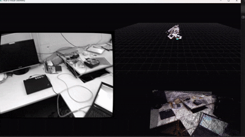

# Hello From SleekSlam 👋 : A direct RGB-D SLAM system, built from scratch


This is my first time implementing SLAM, so going from all the theory (lie groups/algebra... gauss newton/LM optimizations... pose estimation fundamentals) to coding out the full system was definitely challenging. It's a near real-time RGB-D SLAM system written in C++23 and CUDA using the Xbox360 **Kinect v1**. It tracks the camera with a **direct** method (no feature matching in the tracker), keeps a **pose graph** in g2o, 
detects **loop closures** with a bag-of-words vocabulary (rmsalinas FBoW) and RANSAC, and fuses depth into a **GPU TSDF volume** that is turned into a mesh. A Pangolin dashboard shows it all live.

I learned VSLAM from the ground up (see [Study materials](#study-materials)) and then built this to find out whether I really understood it. Everything here is something I implemented, broke, measured and fixed. The honest numbers are in [Results](#results), and the honest weaknesses are in [Limitations and next steps](#limitations-and-next-steps).

---

## Contents

- [What it does](#what-it-does)
- [Results](#results)
- [How it works](#how-it-works)
  - [Camera calibration with mrcal](#camera-calibration-with-mrcal)
  - [Representing camera motion](#representing-camera-motion)
  - [Direct RGB-D odometry](#direct-rgb-d-odometry)
  - [Pose graph and loop closure](#pose-graph-and-loop-closure)
  - [GPU TSDF fusion and meshing](#gpu-tsdf-fusion-and-meshing)
  - [Threading](#threading)
  - [Viewer](#viewer)
- [Design considerations](#design-considerations)
- [Understanding my results](#understanding-my-results)
- [Testing and verification](#testing-and-verification)
- [Building](#building)
- [Running](#running)
- [Project layout](#project-layout)
- [Limitations and next steps](#limitations-and-next-steps)
- [Study materials](#study-materials)

---

## What it does

| Stage | What I built |
|---|---|
| Calibration | mrcal splined lens models for both Kinect cameras, an IR-to-RGB extrinsic solve, and dense undistortion lookup maps for `cv::remap` |
| Tracking | Frame-to-frame direct odometry: photometric + geometric (point-to-plane) residuals, coarse-to-fine over a 4-level pyramid, CUDA-accelerated |
| Back end | g2o pose graph (SE(3) vertices, relative-pose edges, Huber-robust loop edges), optimized when a loop is found and again at the end |
| Loop closure | ORB + FBoW place recognition, 3D back-projection from depth, 3-point RANSAC + SVD rigid fit |
| Mapping | Projective TSDF on the GPU (one thread per voxel), mesh export to PLY, rebuilt from the optimized poses after the run |
| Viewer | Pangolin dashboard: live image, global map + trajectory, first-person point-cloud view |
| Engineering | Modern CMake library (`sleekslam`), presets, warnings module, dependency module, GoogleTest, and built-in numerical self-tests |

---

## Results

Evaluated on the TUM RGB-D **`freiburg1_room`** sequence (48.9 s, 15.989 m of ground-truth path, 1360 frames processed) with [`evo`](https://github.com/MichaelGrupp/evo). All 1360 estimated poses were matched to ground truth (`--t_max_diff 0.02`).

**Absolute trajectory error (ATE), translation part**

| Alignment | RMSE | Mean | Median | Std | Min | Max |
|---|---|---|---|---|---|---|
| SE(3) (rigid) | **0.0790 m** | 0.0746 | 0.0691 | 0.0259 | 0.0174 | 0.1411 |
| Sim(3) (rigid + scale) | **0.0684 m** | 0.0643 | 0.0599 | 0.0234 | 0.0196 | 0.1336 |

**Relative pose error (RPE), consecutive frames, not aligned:** RMSE **6.5 mm**, mean 5.1 mm, median 4.2 mm, max 40 mm.

**How loop closure changed the result** (my own runs on this sequence, SE(3) ATE):

| Stage | ATE RMSE |
|---|---|
| No loop closure | about 0.20 m |
| Loop closure with my first parameter choices | 0.117 m |
| After tuning the loop-closure parameters | **0.079 m** |

**Loop closure in the logged run:** keyframe 1015 matched keyframe 25 with 78 inliers (3D inlier RMSE 3.2 cm). The loop residual went from **0.278 m / 10.03°** before optimization to **0.0012 m / 0.046°** after.

---

## How it works

```
 RGB + depth frames
        │
        ▼
  undistort (remap) ──► build 4-level pyramid (colour/gray/depth, normals)
        │
        ▼
  direct odometry  ◄── constant-velocity prior from previous motion
  (photometric + geometric, coarse→fine, g2o)
        │  T_cr (ref → cur)
        ▼
  T_wc = T_wc · T_cr⁻¹ ──► add pose + sequential edge to pose graph
        │
        ├──► viewer (pose, points, live image)
        │
        └──► every Nth frame: keyframe queue ──► mapping thread
                                                    ├─ GPU TSDF integration
                                                    └─ loop detection ──► loop edge ──► optimize graph
        ▼
   end of sequence: final optimize → export trajectories → rebuild TSDF from optimized poses → save mesh
```

The world frame is the first camera frame (+X right, +Y down, +Z forward). `T_wc` maps camera-frame points to world coordinates. The odometry returns `T_cr`, the transform from the reference frame to the current frame (`p_cur = T_cr · p_ref`).

### Camera calibration with mrcal

I chose **mrcal** for camera calibration because it is robust to lighting conditions and has a much richer lens model than standard OpenCV. Here is how my Kinect v1 IR intrinsics compare with the standard `freiburg1` IR calibration from the TUM dataset:

| | fx | fy | cx | cy |
|---|---|---|---|---|
| Standard Freiburg1 IR | 591.1 | 590.1 | 331.0 | 234.0 |
| My Kinect v1 IR | 587.12 | 587.34 | 315 | 248 |

All results and graphs are in the `Results` folder.

After calibrating each camera, I used the `.cameramodel` files and their corresponding `.vnl` corner-detection files to establish correspondence between the Kinect's two cameras, so that both are looking at the same 3D points. I then computed the 6-DoF extrinsic transform (rotation and translation) from the infrared sensor to the RGB camera by solving chessboard poses across matched frame pairs and optimizing their alignment with the Kabsch/Umeyama algorithm.

`undistortion_map_kinectV1.py` converts mrcal's non-pinhole models (rich spline models with hundreds of parameters) into dense, OpenCV-compatible binary lookup maps. The C++ side uses them with `cv::remap` to rectify distorted images into clean pinhole frames, so the rest of the pipeline can assume a simple pinhole camera.

### Representing camera motion

I don't represent camera motion as a 3×3 rotation matrix plus a 3D vector, for two reasons. Nine numbers for a rotation are harder to optimize over, and not every 3×3 matrix is a valid rotation. Instead, a pose update is a small **6D vector** (3 rotation, 3 translation) that is converted to a valid transformation matrix through the **exponential map** of SE(3). In other words, our Lie algebra pose representation :). I use Sophus for `SE3d` and apply updates with a **left perturbation**, `T ← exp(δ) · T`, consistently in the odometry and in the pose graph.

**The Jacobian.** For each residual I need ∂residual/∂pose: how the residual changes when I nudge the pose by a small correction δ. For the photometric residual (the intensity difference between a reference pixel and where it lands in the current image), the chain rule gives image gradient × projection Jacobian × pose perturbation. The optimizer uses these derivatives to decide which way to move the pose.

### Direct RGB-D odometry

"Direct" means the tracker doesn't extract or match features. It moves the camera pose until the current image lines up with the reference frame, using the pixels and depths themselves.

- **Two kinds of residual are minimized together.** A *photometric* term compares intensities at pixels with strong image gradients. A *geometric* term is a point-to-plane distance using depth and surface normals. The two terms constrain each other: texture helps where depth is flat, and depth helps where the image is blank.
- **Coarse-to-fine.** The pose is solved on a 4-level image pyramid (L3 coarsest, L0 full resolution), each level starting from the previous one's answer. This gives a large convergence basin without needing a good initial guess.
- **Constant-velocity prior.** The previous frame's motion initializes the next solve.
- **Tracking-lost guard.** A solve that fails, moves more than 0.5 m, or rotates more than 30° between two frames is rejected, the frame is skipped, and the motion prior is reset.
- **CUDA.** The expensive per-pixel work runs in CUDA (`RgbdOdometryCuda`). I kept the plain CPU implementation (`RgbdOdometry`) as a reference to compare against.
- **Frame-to-frame.** I track each frame against the previous one. That is simple and fast, but it accumulates drift. It is the main reason the pose graph and loop closure matter so much here, and it's the first thing I'd change (see [next steps](#limitations-and-next-steps)).

### Pose graph and loop closure

**Pose graph.** Each tracked frame adds a vertex (an SE(3) pose) and a sequential edge to the previous one. The relative-pose measurement is `Z_ij = T_wc_i⁻¹ · T_wc_j`, and the error is `log(Z_ij⁻¹ · T_wc_i⁻¹ · T_wc_j)`. The graph uses g2o's Levenberg–Marquardt with Eigen linear solvers. Loop edges get a **Huber robust kernel**; sequential edges don't. 

**Loop detection** runs on keyframes, in a background thread:

1. Detect up to **1200 ORB features** on the keyframe.
2. Score it against all older keyframes with **FBoW** (Bag-of-Words), requiring a score of at least 0.01 and a gap of at least 30 frames.
3. For each candidate, match descriptors with a brute-force matcher and a **ratio test of 0.65**.
4. **Back-project** the matched keypoints to 3D using the depth image (valid range 0.05–3.7 m) and require at least 30 valid 3D correspondences.
5. Estimate the relative transform with **3-point RANSAC** (1200 iterations, 6 cm inlier threshold), then refit on all inliers with an SVD.
6. Accept only if there are **at least 35 inliers** and the **inlier RMSE is at most 3.5 cm**. The best candidate (most inliers, then lowest RMSE) becomes a loop edge.

When a loop is found, the edge is added (information weight 1.0, Huber δ = 1.2) and the graph is optimized for up to 40 iterations. The correction goes into the graph; the live tracker keeps running from its own estimate. At the end of the sequence the graph is optimized once more, and the trajectory and TSDF map are rebuilt from the optimized poses.

### GPU TSDF fusion and meshing

The map is a **projective TSDF** (truncated signed distance field) held on the GPU (`tsdf_gpu.cu`):

- The volume is **512³ voxels at 1.5 cm**, covering 7.68 m per side. At 8 bytes per voxel (a 32-bit distance, a 16-bit weight and 16 bits of padding), that's 1 GiB of device memory. Truncation is 4.5 cm (3 voxels).
- **One CUDA thread per voxel.** Each thread transforms its voxel centre into the camera frame, projects it into the depth image, and computes `sdf = measured depth − voxel depth`. Voxels more than one truncation distance *behind* the surface are skipped (they are occluded).
- A frame is integrated only if it is a **keyframe** (moved at least 1.5 cm or rotated at least 2° since the last one, or 30 frames have passed).
- After the sequence, the volume is **reset and rebuilt from the loop-corrected keyframe poses**, then the mesh is extracted and saved as PLY. I export both `mesh_before_optimization.ply` and `mesh.ply` so the effect of loop closure is visible.

### Threading

Three threads share the work:

- **Tracking thread**: read, undistort, pyramid, odometry, pose graph update, keyframe enqueue.
- **Mapping thread**: pops keyframes from a thread-safe queue, integrates them into the TSDF, runs loop detection and the loop-triggered graph optimization.
- **Viewer thread**: all OpenGL calls happen here, and it only reads immutable snapshots handed over under a mutex.

All pose-graph access is serialized with a mutex, because the tracker adds poses while the mapper optimizes.

### Viewer

The Pangolin dashboard has three panels: the live camera image (`1` RGB, `2` grayscale, `3` depth), the global 3D map with the full trajectory and current pose, and a first-person view of the accumulated cloud from the current camera. `p` toggles the global points, `f` the first-person points, `Esc` closes it.

---

## Design considerations

### Why Huber and not Tukey

Both are robust loss functions that stop outliers from dominating the fit. In a coarse-to-fine direct method, the first iterations at a coarse level often start with *large residuals that are mostly correct information* about how far the pose still has to move. Tukey would throw them away, and the optimizer can stall in a flat region, so it needs a good initial guess and a good scale estimate.

**Huber** is quadratic near zero and linear in the tails. It is convex, so there is a single minimum, and large residuals still pull on the solution with bounded influence. That is a better fit for this problem, where the starting point is rough. I haven't run a systematic Tukey-versus-Huber comparison on this dataset, so this is my reasoning and not a measured result.

One thing I did measure: g2o applies Huber's delta to the *whitened error magnitude*, so δ is in units of σ. I wrote a self-test that checks this (using δ = 1.345, the classic 95%-efficiency constant). Loop edges use δ = 1.2.

### Why standard image downsampling fails on depth

Normal downsampling (Gaussian blur, bilinear interpolation) **averages depth across object boundaries**. A foreground wall at 1 m next to a background wall at 5 m gets blended into a surface at 3 m, which doesn't exist. Those fake floating points corrupt both the geometric residuals and the normals.

My pyramid uses a **conditional neighbour average**. For every 2×2 block it looks at the surrounding 3×3 window, but it only averages neighbours whose depth is within **5%** (`relTol`) of the centre depth `zc`. A neighbour that differs wildly is an object edge and is ignored.

### Why a pose graph on top of odometry

Frame-to-frame odometry only knows how the camera moved *between* two frames, and every small error accumulates. The pose graph turns "where did I move" into a set of constraints that can be re-solved when new information, such as a loop closure, arrives. 

---

## Understanding my results

**Loop closure worked as intended.** The residual after optimization was 1.2 mm and 0.046°, so the optimizer satisfied the loop almost exactly. 

**Mean ≈ median, with a small standard deviation.** (Mean 0.064 m, median 0.060 m, std 0.023 m under Sim(3).) The error is a fairly uniform offset rather than a few catastrophic spikes. The worst pose is 13–14 cm off, and even the best is about 2 cm off.

**Where one tracked frame spends its time** (a single frame from the log: 86.1 ms in total, about 21.5 FPS). The per-level timers add up to about 69 ms, and the rest is outside them.

| Level | Select (photo + geo) | Graph build | Optimize | Photo residuals | Geo residuals |
|---|---|---|---|---|---|
| L3 | 4.21 ms | 0.49 ms | 1.62 ms | 1,744 | 2,749 |
| L2 | 4.38 ms | 0.84 ms | 2.90 ms | 4,651 | 12,512 |
| L1 | 8.14 ms | 3.14 ms | 6.47 ms | 12,108 | 53,374 |
| L0 | 20.78 ms | 8.04 ms | 7.88 ms | 24,474 | 215,682 |

L0 costs more than half of the level time, and geometric sample selection at L0 (13.5 ms) is the single largest item. That is where I'd start on speed. The program also prints a full performance summary (tracking FPS and p50/p95/p99 latency) at the end of every run.

---

## Testing and verification

I wanted to be able to trust the numbers, so there are three layers of checks.

**1. Built-in numerical self-tests** (`main --selftest`), which check the maths the optimizer depends on:

- SE(3) exp/log round trip (error below 1e-9, rotations stay valid)
- optimized photometric interpolation matches the reference bilinear interpolation (below 1e-4)
- analytic photometric Jacobian agrees with a numerical Jacobian (relative error below 0.15; this tolerance is loose because of image-gradient interpolation)
- analytic geometric Jacobian agrees with a numerical Jacobian on an exact tilted plane (relative error below 1e-2)
- g2o's Huber kernel behaves as I assume (delta is in units of σ)

**2. A GoogleTest for the back end** (`tests/`): *the pose graph recovers a known trajectory.* It builds a synthetic square path of 40 poses (4 sides of 10 steps, 0.5 m per step, 90° turns), corrupts the odometry with a deterministic systematic drift (5 mm and 0.002 rad per step), adds one loop-closure edge from the true transform, and optimizes. It asserts that drift is really present before optimization (RMSE above 0.10 m), that the error afterwards is below 0.06 m and at least 3× smaller than before, and that the closed pose lands within 2 cm of the truth. There is no randomness and no dataset, so it runs in CI.

**3. End-to-end evaluation** with `evo` on the TUM sequence (see [Running](#running)).

---

## Building

### Requirements

- Windows 10/11, **Visual Studio 2022** (MSVC v143), CMake 3.24 or newer
- **CUDA 12.2** (compute capability 7.5 target; the code is built for `sm_75`)
- OpenCV 4.14 (a custom build), Eigen 5.0, Sophus, g2o, Pangolin, GLEW, **FBoW**, GoogleTest. Most come through vcpkg.
- An ORB vocabulary in FBoW format (`config/orb_mur.fbow`)

### Configure and build

```powershell
cmake -S . -B build -G "Visual Studio 17 2022" -A x64 `
      -T "v143,version=14.44,cuda=12.2" `
      -DCMAKE_TOOLCHAIN_FILE="$env:VCPKG_ROOT/scripts/buildsystems/vcpkg.cmake" `
      -DCMAKE_CUDA_FLAGS="-allow-unsupported-compiler -D_ALLOW_COMPILER_AND_STL_VERSION_MISMATCH"
cmake --build build --config Release
```

The same settings can be captured in `CMakePresets.json` so they don't have to be typed by hand.

### Notes on the build

I had to learn Modern CMake for this, and these are the decisions I'd want to remember:

- **A library, `sleekslam`**, is an `INTERFACE` target. It carries the include paths, the C++23 requirement and the link line for all dependencies. `main` and the tests just link to it.
- **A separate static library, `sleekslam_cuda`**, holds the `.cu` files. Its headers deliberately do *not* include the project's precompiled header, which pulls Pangolin and g2o into nvcc and breaks the compile.
- **Two language standards.** Host code is C++23 and CUDA code is C++17. Anything that needs `std::println` or `std::format` stays out of headers that `.cu` files include.
- **Toolset mismatch.** CUDA 12.2 predates the newest MSVC STL. The vcpkg libraries were built with a newer toolset, so linking with an older one gave `__std_*` unresolved symbols, and I had to build with toolset 14.44. The CUDA library stays on 14.38, which CUDA 12.2 accepts. The `-allow-unsupported-compiler` and `_ALLOW_COMPILER_AND_STL_VERSION_MISMATCH` flags are needed at *configure* time, because compiler detection compiles a tiny `.cu` file first.
- **Runtime DLLs** are copied next to the executable after the build. Libraries linked by raw `.lib` path (FBoW, OpenCV) have to be copied explicitly, because CMake doesn't know their DLLs.
- **Modules** `cmake/Dependencies.cmake` and `cmake/CompilerWarnings.cmake` keep the root `CMakeLists.txt` short.
- **Options:** `SLEEKSLAM_BUILD_TESTS` (default ON) and `SLEEKSLAM_USE_SANITIZERS` (ASan/UBSan, GCC/Clang only).

---

## Running

```powershell
.\build\bin\Release\main.exe --dir <output dir with camera_params.yaml> --frames-dir <frames dir>
```

| Flag | Meaning |
|---|---|
| `--dir` | output directory; also where `camera_params.yaml` is read from |
| `--frames-dir` | directory with `frame_XXXX.png` (depth) and `frame_XXXX_rgb.png` (colour) |
| `--first N` | first frame index |
| `--max-frames N` | stop after N frames (0 = all) |
| `--keyframe-every N` | keyframe interval (default 5) |
| `--no-viewer` | headless run |
| `--selftest` | run the numerical self-tests and exit |

**Outputs** go to `--dir`: `trajectory_before.txt` and `trajectory_after.txt` (TUM format), `mesh_before_optimization.ply` and `mesh.ply`.

### Reproducing the TUM evaluation

1. `prepare_tum.py` converts a downloaded TUM sequence into the frame layout above and writes `frame_times.txt`, which maps each frame index to its real RGB and depth timestamps.
2. Run the system on it.
3. The trajectory files use frame indices as timestamps, so `fix_trajectory_timestamps.py` restores the real ones from `frame_times.txt` before evaluation.
4. Evaluate with evo:
   ```bash
   evo_ape tum groundtruth.txt trajectory_tum_fixed.txt --align --t_max_diff 0.02              # SE(3)
   evo_ape tum groundtruth.txt trajectory_tum_fixed.txt --align --correct_scale --t_max_diff 0.02 # Sim(3)
   evo_rpe tum groundtruth.txt trajectory_tum_fixed.txt --delta 1 --delta_unit m --t_max_diff 0.02
   ```
5. `plot_trajectory.py` makes the interactive plots (overlays, error over time, per-axis, 3D). It matches poses to ground truth by timestamp, not array position. Pairing by index was a bug in my first plotting script that made the plots meaningless.

---

## Project layout

```
include/sleekslam/
  core/        camera model, frame and pyramid construction
  odometry/    direct odometry (CPU + CUDA), photometric and geometric residuals, CUDA kernels
  backend/     pose graph, loop closure, keyframe records, thread-safe queue, self-tests
  mapping/     TSDF (CPU reference + CUDA), fusion mapper, mesh export
  viewer/      Pangolin dashboard
src/           main.cpp and the precompiled headers
cmake/         Dependencies.cmake, CompilerWarnings.cmake
config/        ORB vocabulary for FBoW
tests/         GoogleTest suite
```

---

## Limitations and next steps

I'd rather list these myself than have someone find them.

- **Drift comes from frame-to-frame tracking.** Tracking against a keyframe or against the TSDF model would accumulate far less error. This is the biggest accuracy improvement available.
- **Speed.** One frame measured 86 ms (about 21.5 FPS), and I want real-time performance. Geometric sample selection at the finest level is the first target.
- **Pose-graph Jacobians are numerical.** Analytic ones would be faster.
- **Loop search is brute force** over all earlier keyframes that pass the BoW threshold. That's fine for a room, and it won't scale to a building.
- **My own Kinect captures** don't have ground truth, so I can only judge those maps visually.

---

## Study materials

- *A micro Lie theory for state estimation in robotics*, Solà, Deray, Atchuthan
- *Introduction to Visual SLAM: From Theory to Practice*, Xiang Gao and Tao Zhang
- Photogrammetry YouTube lecture series by Cyrill Stachniss

Tools and datasets: [TUM RGB-D benchmark](https://cvg.cit.tum.de/data/datasets/rgbd-dataset), [mrcal](https://mrcal.secretsauce.net), [evo](https://github.com/MichaelGrupp/evo), [g2o](https://github.com/RainerKuemmerle/g2o), [Sophus](https://github.com/strasdat/Sophus), [Pangolin](https://github.com/stevenlovegrove/Pangolin), [FBoW](https://github.com/rmsalinas/fbow).
